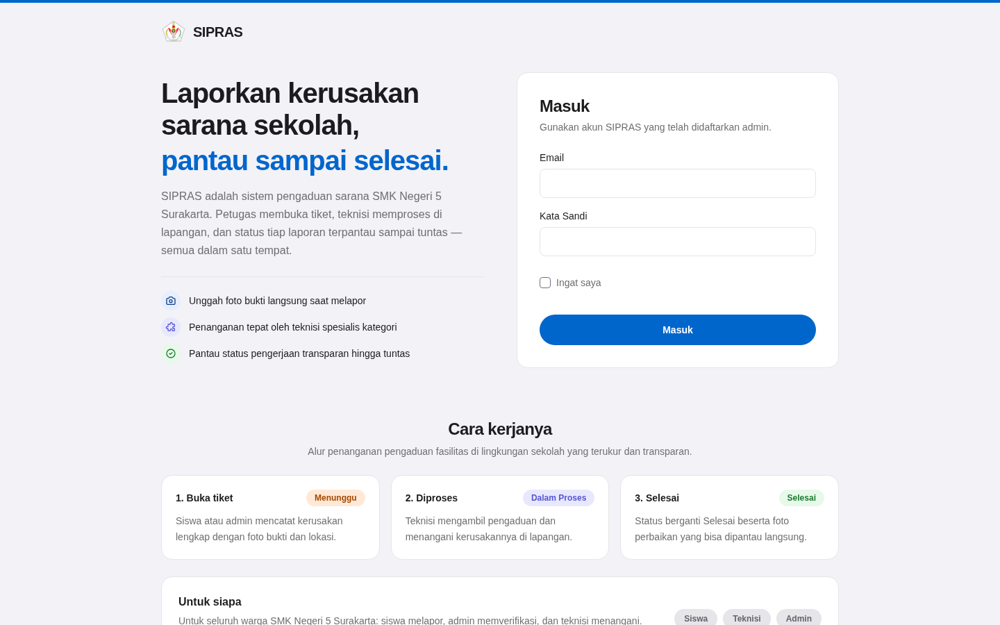
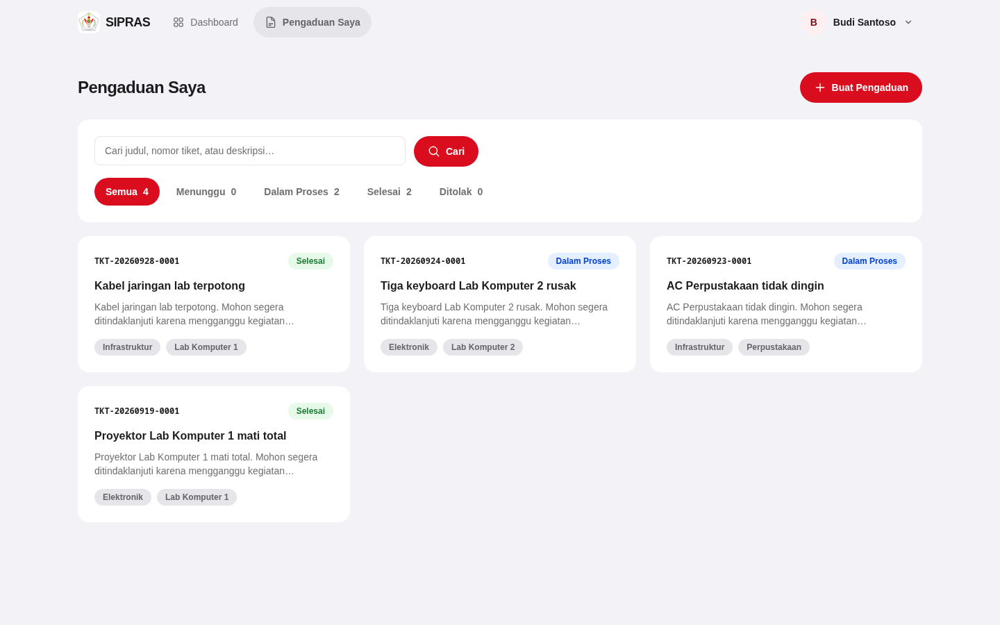
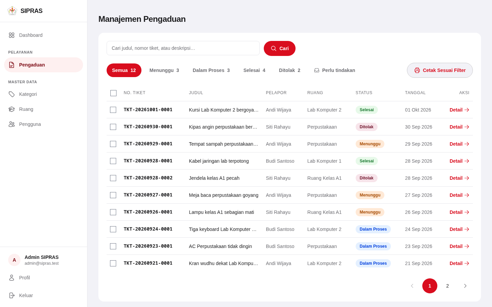
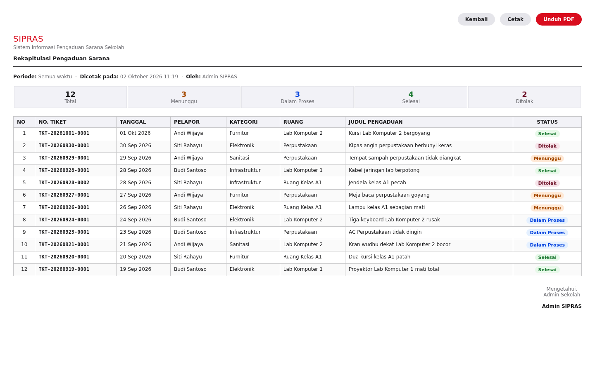

# SIPRAS — Sistem Informasi Pengaduan Sarana Sekolah

[](https://github.com/varrver/sipras/actions/workflows/tests.yml)

SIPRAS is a school facilities complaint platform (Helpdesk/Ticketing System) built with
**Laravel 13**. Students report damaged school facilities with photo evidence; admins triage,
track and resolve the reports through a transparent status workflow.

**Live demo:** <https://sipras.wasmer.app> — sign in with any account from
[Demo Accounts](#demo-accounts) (`password`). The demo is seeded with sample data;
feel free to file and triage complaints.

> School project — SMK Negeri 5 Surakarta, Grade XII RPL.
> Sub-theme: *Sistem Pengaduan Sarana Sekolah* (Project Guideline 2026/2027).

## Tech Stack

- **Backend:** Laravel 13 (PHP ≥ 8.3), Blade templates
- **Frontend:** Tailwind CSS 4 (Vite) + Alpine.js — no other JS frameworks
- **Database:** MySQL / MariaDB (dev: MariaDB 10.4) — tests run on in-memory SQLite
- **Auth:** Laravel Breeze (Blade stack) with role-based middleware (`admin` / `siswa`)
- **PDF export:** barryvdh/laravel-dompdf

## Features

**Authentication** — login/logout, profile and password change (password-confirmed).
There is no public registration and no self-service password reset: accounts are
provisioned and forgotten passwords are reset by an admin at `/admin/master/users`.

**Siswa (student)**
- Submit complaints with photo evidence — each gets a ticket number (`TKT-YYYYMMDD-XXXX`)
- Track their own complaints: status timeline, admin notes, and resolution proof photo
- Search and filter their own list; withdraw a still-pending complaint (confirm modal)
- Dashboard with their complaint statistics

**Admin**
- Dashboard with live global counts per status
- Master data CRUD: users (with role assignment & password reset), categories, rooms
- Complaint triage: filter chips with live counts, keyword search, period filter
  (presets + custom range — the report honors them too), "needs action" sort pin
- Status workflow on the detail page: `pending → in_progress → resolved / rejected`
  - Rejection requires admin notes; resolution stamps `resolved_at` and accepts a proof photo
  - Bulk status updates across selected rows (all-or-nothing, behind a confirm dialog)
- Status timeline on the detail pages of both roles, showing the ticket's progression
- Printable recap report + PDF export, both honoring the active filters
- Safety rails: categories/rooms still referenced by complaints cannot be deleted;
  deleting a user sweeps their complaint files and sessions (no orphans)

## Screenshots

| Landing page | Siswa — complaint list |
| --- | --- |
|  |  |

| Admin — complaint triage | Admin — recap report |
| --- | --- |
|  |  |

Every screen, both roles, is in [`docs/screenshots/`](docs/screenshots).

## Demo Accounts

All four seeded accounts use the password `password`.

| Role  | Email               |
|-------|---------------------|
| Admin | `admin@sipras.test` |
| Siswa | `budi@siswa.test`   |
| Siswa | `siti@siswa.test`   |
| Siswa | `andi@siswa.test`   |

## Setup

Requirements: PHP ≥ 8.3 with `pdo_mysql`, `dom`, and `fileinfo` extensions, Composer, Node.js.

```bash
# 0. Clone the repository
git clone https://github.com/varrver/sipras.git
cd sipras

# 1. Install dependencies
composer install
npm install

# 2. Environment — copy the example, then edit the database block
cp .env.example .env
php artisan key:generate
#   For MySQL/MariaDB, set in .env:
#     DB_CONNECTION=mysql
#     DB_HOST=127.0.0.1
#     DB_PORT=3306
#     DB_DATABASE=sipras
#     DB_USERNAME=root
#     DB_PASSWORD=
#   and set APP_LOCALE=id — the UI text is Indonesian

# 3. Database — migrations + demo data (4 accounts, master data,
#    and 12 complaints spread across every status)
php artisan migrate --seed

# 4. Public storage link (complaint photos)
php artisan storage:link

# 5. Build frontend assets
npm run build

# 6. Serve — `composer serve` clears compiled views first (avoids serving a
#    stale Blade render); plain `php artisan serve` works too
composer serve
```

Open http://127.0.0.1:8000 and sign in with a demo account.

> While developing the UI, `composer dev` runs the server, queue worker, log tail
> and Vite in one place. A stale `public/hot` file after an unclean Vite exit makes
> the app render unstyled — delete it or restart the process.

## Testing

```bash
composer test        # config:clear + artisan test
```

The full suite runs on in-memory SQLite — no MariaDB needed to run it. This README
deliberately cites no test numbers: the count moves with the code, so trust the run itself.

CI runs the same suite on every push to `main` and every pull request
([`.github/workflows/tests.yml`](.github/workflows/tests.yml)), PHP 8.5 with in-memory SQLite.

## Contributing

Issues and pull requests are welcome — this is a school project, so small, focused
changes are easiest to review. UI copy stays Indonesian, identifiers stay English,
and new screens follow the tokens and components in [`DESIGN.md`](DESIGN.md).

```bash
composer install && npm install   # once
composer test                     # suite on in-memory SQLite
npm run build                     # required before the browser shows styling
vendor/bin/pint                   # format before committing
```

`composer dev` runs the server, queue worker, log tail and Vite together while you work.

## Docs

- [`docs/user-manual.md`](docs/user-manual.md) — step-by-step user manual for both roles, with screenshots
- [`docs/erd.md`](docs/erd.md) — entity relationship diagram and data dictionary
- [`docs/use-case-flowchart.md`](docs/use-case-flowchart.md) — use case diagram and workflow flowchart (report §3.2 figures)
- [`docs/screenshots/`](docs/screenshots) — screenshots of every screen, both roles
- [`PRD.md`](PRD.md) — authoritative product requirements (spec)
- [`DESIGN.md`](DESIGN.md) — UI design system: tokens, components, conventions
- [`AGENTS.md`](AGENTS.md) — repository guidance for AI coding agents

## License

MIT — see [`LICENSE`](LICENSE). Built as a Grade XII RPL project assessment for
SMK Negeri 5 Surakarta.
