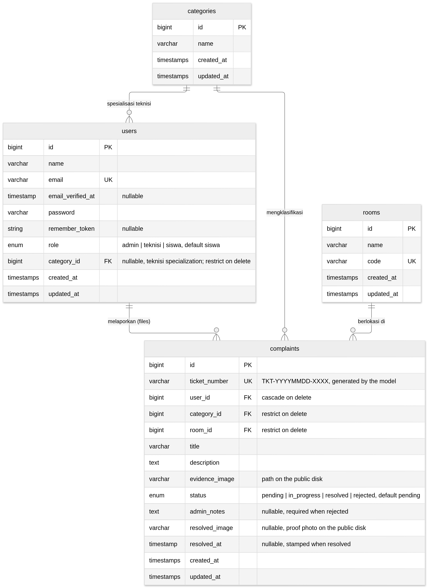
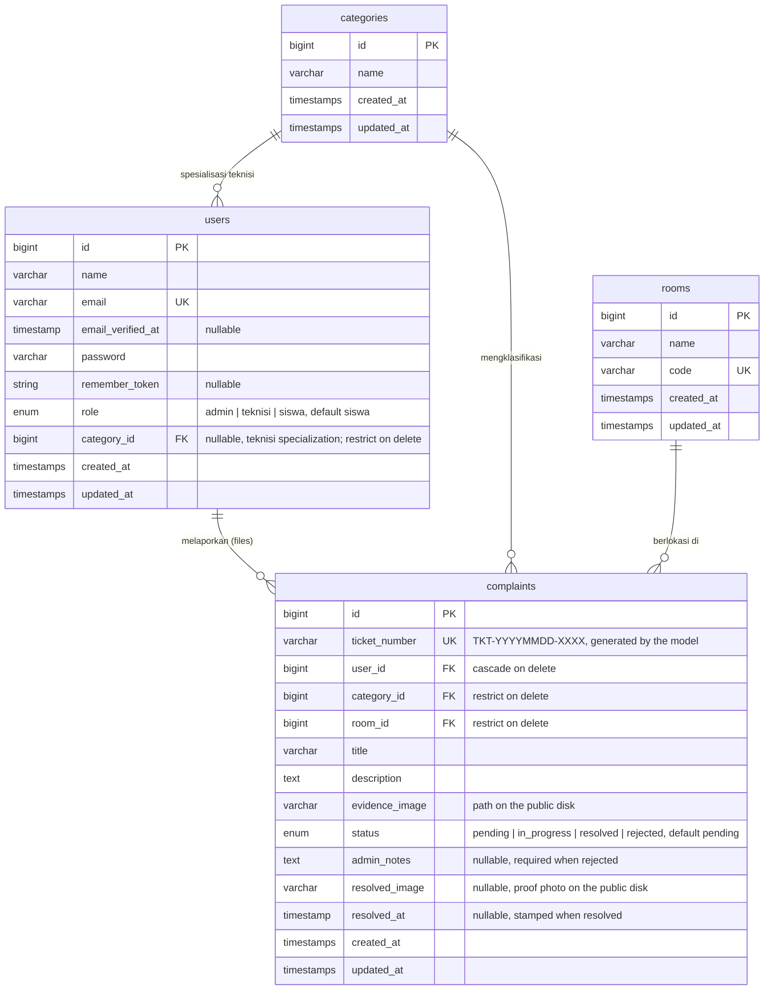
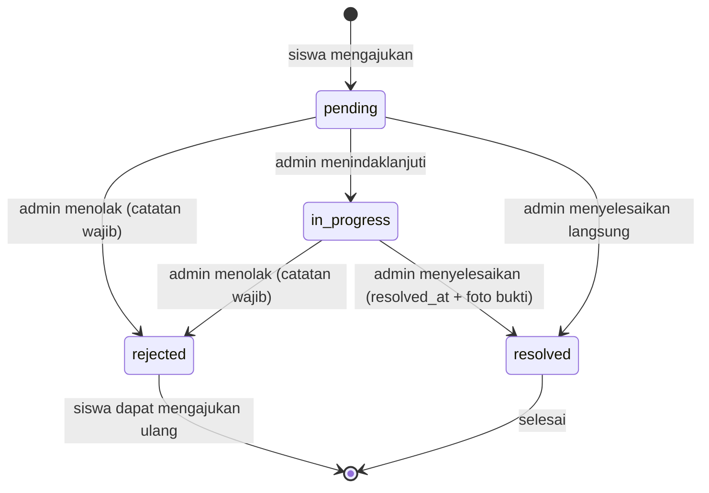

# SIPRAS — Entity Relationship Diagram (ERD)

> Generated from the Laravel migrations in `database/migrations/` — the schema is
> the single source of truth, and this document describes exactly what it creates.
> Domain tables only: the framework tables Laravel ships are listed at the bottom.

## Diagram

<!-- figure: erd -->

> The PNG above is rendered from the block below — regenerate it with
> `python3 scripts/render_diagrams.py` (renders this exact block via
> mermaid.ink).

## Relationships

| Relationship | Cardinality | On delete |
| --- | --- | --- |
| `users` → `complaints` | one-to-many (a student files many complaints) | **cascade** — deleting a user deletes their complaints (the app also sweeps their uploaded files) |
| `categories` → `complaints` | one-to-many (a category groups many complaints) | **restrict** — a category still referenced by a complaint cannot be deleted |
| `categories` → `users` | one-to-many (a category hosts the teknisi accounts specializing in it) | **restrict** — a category with an assigned teknisi cannot be deleted until the account is reassigned |
| `rooms` → `complaints` | one-to-many (a room hosts many complaints) | **restrict** — a room still referenced by a complaint cannot be deleted |

## Data dictionary

### `users` — account holders, both roles

| Column | Type | Constraints | Notes |
| --- | --- | --- | --- |
| `id` | BIGINT UNSIGNED | PK, auto-increment | |
| `name` | VARCHAR(255) | not null | Display name |
| `email` | VARCHAR(255) | not null, **unique** | Login identifier |
| `email_verified_at` | TIMESTAMP | nullable | Breeze verification stamp |
| `password` | VARCHAR(255) | not null | Bcrypt hash |
| `remember_token` | VARCHAR(100) | nullable | "Remember me" token |
| `role` | ENUM(`admin`, `teknisi`, `siswa`) | not null, default `siswa` | Read by `RoleMiddleware` (`role:admin` / `role:teknisi` / `role:siswa`) |
| `category_id` | BIGINT UNSIGNED | nullable, FK → `categories.id` | The teknisi specialization (required for `teknisi` accounts at validation, null for every other role) |
| `created_at` / `updated_at` | TIMESTAMP | not null | |

### `categories` — complaint classification (master data)

| Column | Type | Constraints | Notes |
| --- | --- | --- | --- |
| `id` | BIGINT UNSIGNED | PK, auto-increment | |
| `name` | VARCHAR(255) | not null | e.g. *Elektronik*, *Bangunan* |
| `created_at` / `updated_at` | TIMESTAMP | not null | |

### `rooms` — school locations (master data)

| Column | Type | Constraints | Notes |
| --- | --- | --- | --- |
| `id` | BIGINT UNSIGNED | PK, auto-increment | |
| `name` | VARCHAR(255) | not null | e.g. *Lab Komputer 1* |
| `code` | VARCHAR(255) | not null, **unique** | Short room code |
| `created_at` / `updated_at` | TIMESTAMP | not null | |

### `complaints` — the transactional core

| Column | Type | Constraints | Notes |
| --- | --- | --- | --- |
| `id` | BIGINT UNSIGNED | PK, auto-increment | |
| `ticket_number` | VARCHAR(255) | not null, **unique** | `TKT-YYYYMMDD-XXXX`, auto-generated by the `Complaint` model on create |
| `user_id` | BIGINT UNSIGNED | FK → `users.id`, not null | The reporting student |
| `category_id` | BIGINT UNSIGNED | FK → `categories.id`, not null | What kind of damage |
| `room_id` | BIGINT UNSIGNED | FK → `rooms.id`, not null | Where the damage is |
| `title` | VARCHAR(255) | not null | Short summary |
| `description` | TEXT | not null | Full report from the student |
| `evidence_image` | VARCHAR(255) | not null | Uploaded photo, stored at `complaints/evidence/` on the `public` disk |
| `status` | ENUM(`pending`, `in_progress`, `resolved`, `rejected`) | not null, default `pending` | The workflow; labels live in `Complaint::STATUS_LABELS` |
| `admin_notes` | TEXT | nullable | Admin note; **required when status = `rejected`** (validation-enforced) |
| `resolved_image` | VARCHAR(255) | nullable | Proof photo after the fix, stored at `complaints/resolved/` |
| `resolved_at` | TIMESTAMP | nullable | Stamped automatically when status moves to `resolved` |
| `created_at` / `updated_at` | TIMESTAMP | not null | `created_at` is the filing time shown in the UI |

### Status workflow

## Framework tables (not part of the domain model)

| Table | Purpose |
| --- | --- |
| `cache`, `cache_locks` | Laravel cache + atomic-lock stores (unused in this app's config) |
| `jobs`, `job_batches`, `failed_jobs` | Queue backend tables (queue connection is `sync`/`null` in this app) |
| `password_reset_tokens` | Breeze password-reset tokens, keyed by email |
| `sessions` | Database session driver table (dev uses the file driver) |

These are created by Laravel's stock migrations (`0001_01_01_*`) and carry no foreign keys into the domain tables.
