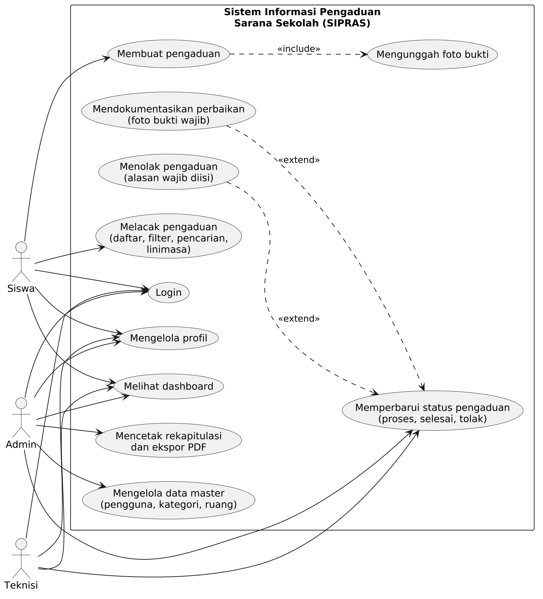
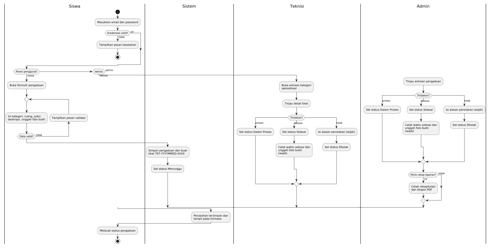

# SIPRAS — Use Case Diagram & Flowchart (Bab 3.2)

> The workflow diagrams for section 3.2 (*Alur Kerja Sistem*) of the project
> report — the guideline's Week-1 deliverable
> (*Dokumen Analisis Kebutuhan & Alur Kerja: Flowchart/Use Case*).
> Behavior is derived from the controllers and `Complaint` model; diagram
> labels are Indonesian because the figures appear in the (Indonesian) report.

## Use case diagram (Gambar 3.1)

<!-- figure: use-case -->


| Actor | Use cases |
| --- | --- |
| Siswa | Login, mengelola profil, melihat dashboard, **membuat pengaduan** (include: unggah foto bukti), melacak pengaduan (daftar, filter, pencarian, linimasa) |
| Admin | Login, mengelola profil, melihat dashboard, mengelola data master (pengguna, kategori, ruang), **memperbarui status pengaduan** (termasuk aksi massal), mencetak rekapitulasi & ekspor PDF |

Stereotypes:

- `<<include>>` — *Mengunggah foto bukti* is a mandatory part of *Membuat
  pengaduan* (validation requires an evidence photo, `evidence_image` NOT NULL).
- `<<extend>>` — *Menolak pengaduan* (rejection requires admin notes) and
  *Mendokumentasikan perbaikan* (optional proof photo + `resolved_at` stamp)
  both conditionally extend *Memperbarui status pengaduan*.

## Flowchart alur kerja (Gambar 3.2)

<!-- figure: flowchart -->


Swimlanes map to the real actors: **Siswa** fills the complaint form in a
validation loop until it passes; **Sistem** stores the complaint, generates the
`TKT-YYYYMMDD-XXXX` ticket and sets status *Menunggu*; **Admin** triages the
queue and updates the status — *Dalam Proses*, *Selesai* (stamps `resolved_at`
plus optional proof photo) or *Ditolak* (mandatory reason) — and can print the
recap / export a PDF. Every change immediately shows up in the timeline the
student tracks.

## Sources & rendering

- Each `.puml` beside its PNG is the canonical source (committed; edit these,
  not the PNGs); the PNG is the rendered output the docx embeds.
- The filenames are named once in `scripts/figures.py`. The image links above
  are generated from it by `python3 scripts/sync_figure_links.py`, so they
  cannot drift from what the renderer writes.

Render (needs internet; uses the public PlantUML server, no local Java):

```bash
python3 scripts/render_diagrams.py
```

The script deflates + encodes each `.puml` into the server URL, checks the SVG
output for syntax errors, then writes the PNG and prints its pixel size.
