# SIPRAS — User Manual

> Panduan penggunaan SIPRAS (Sistem Informasi Pengaduan Sarana Sekolah) for both
> roles: **Siswa** (student) and **Admin** (school facilities staff).
> Screenshots were taken from the seeded demo data described in the
> [Appendix](#appendix-seeded-demo-data).

SIPRAS is a web app where students report damaged school facilities with photo
evidence, and the facilities team triages, tracks and resolves those reports
through a transparent status workflow. This manual walks through every screen
in the order a real user meets it.

- **Part 1 — Siswa:** log in, browse the dashboard, submit a complaint, track
  its progress.
- **Part 2 — Admin:** triage the complaint queue, update statuses, manage
  master data, and produce the printable/PDF recap report.

## Contents

1. [Getting started](#getting-started)
2. [Understanding complaint statuses](#understanding-complaint-statuses)
3. [Part 1 — Siswa (student)](#part-1--siswa-student)
4. [Part 2 — Admin](#part-2--admin)
5. [Appendix — seeded demo data](#appendix-seeded-demo-data)

---

## Getting started

### Running the app

Start the development server, then open the app in a browser:

```bash
php artisan serve          # http://127.0.0.1:8000
```

Full installation steps live in the [README](../README.md#setup). There is no
public registration — accounts are created by an admin (see
[Managing users](#managing-users)).

### Logging in

Every user signs in with an email and password. Tick **Ingat saya** to stay
signed in across browser restarts.

There is no "Lupa kata sandi?" link anywhere in SIPRAS: accounts are
provisioned by an admin, and a forgotten password goes through them too — an
admin can reset it for you at `/admin/master/users`.

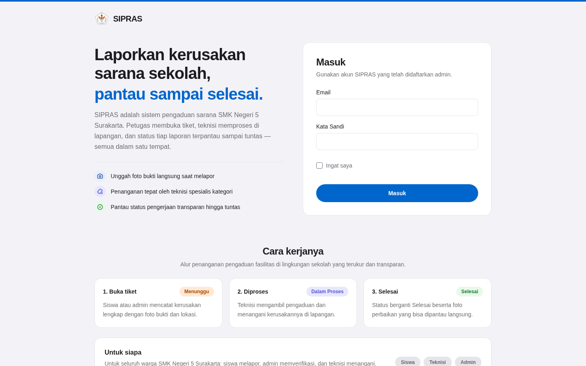

After signing in, SIPRAS routes each role to its own home: students land on
**Dashboard Siswa**, admins on **Dashboard Admin**. A user can never open the
other role's pages — the URL simply answers *403 Forbidden*.

### Demo accounts

| Role  | Email               | Password   |
| ----- | ------------------- | ---------- |
| Admin | `admin@sipras.test` | `password` |
| Siswa | `budi@siswa.test`   | `password` |
| Siswa | `siti@siswa.test`   | `password` |
| Siswa | `andi@siswa.test`   | `password` |

### Logging out

Open the account menu in the navigation bar and click **Keluar**. Admins find
it at the bottom of the sidebar; students at the top-right avatar menu.

### Your profile

Every account can update its own name, email and password (and delete its own
account) from **Profil** in the same account menu. Changes apply immediately.

## Understanding complaint statuses

Every complaint moves through one workflow. The same four labels appear
everywhere in the app — status badges, the list filters, dashboard cards and
the printed report:

| Status        | Label (in the app) | Meaning                                              |
| ------------- | ------------------ | ---------------------------------------------------- |
| `pending`     | **Menunggu**       | Filed, not yet reviewed by the facilities team.      |
| `in_progress` | **Dalam Proses**   | Accepted and being worked on.                        |
| `resolved`    | **Selesai**        | Fixed — the completion time and (optionally) a proof photo are recorded. |
| `rejected`    | **Ditolak**        | Not actionable; the admin must give a reason the student can read. |

Each complaint carries a permanent ticket number, `TKT-YYYYMMDD-XXXX`
(date + sequence of the day, e.g. `TKT-20260919-0001`), generated automatically
when the complaint is submitted. Quote it when referring to a report.

---

## Part 1 — Siswa (student)

### Dashboard

The student dashboard opens with five summary cards — **Total Pengaduan**
plus one card per status — counting only *your own* complaints, followed by
**Pengaduan Terbaru**, your five most recent reports.

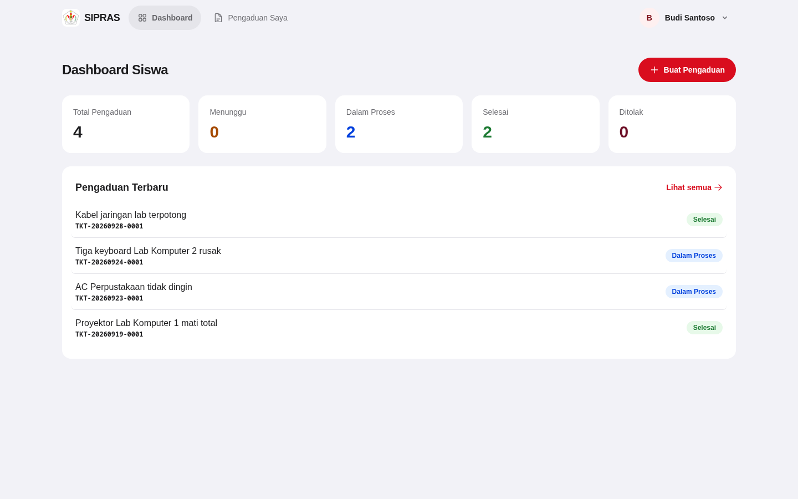

Every card links into [Pengaduan Saya](#my-complaints-pengaduan-saya)
filtered to that status, so a count is always one click away from its list.

### Submitting a complaint

Click **Buat Pengaduan** (on the dashboard or at the top of *Pengaduan Saya*)
and fill in the form:

| Field            | Required | Rules                                        |
| ---------------- | -------- | -------------------------------------------- |
| Kategori         | yes      | Pick from the list maintained by the admin.  |
| Ruang            | yes      | Pick from the list maintained by the admin.  |
| Judul Pengaduan  | yes      | Short summary, max 255 characters.           |
| Deskripsi        | yes      | Explain the damage and when it started.      |
| Foto Bukti       | yes      | JPG/PNG, max 2 MB — a live preview appears once chosen. |

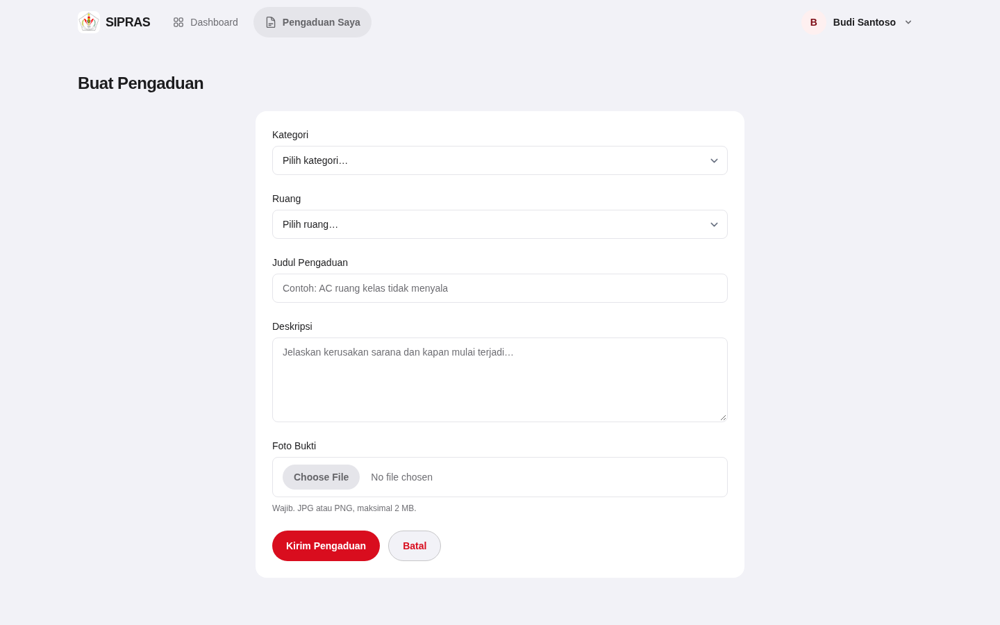

Click **Kirim Pengaduan**. If anything is missing or invalid the form tells
you in Indonesian what to fix (e.g. *"Foto bukti wajib diunggah."*) and keeps
what you already typed. On success the complaint is filed with status
**Menunggu** and gets its ticket number — you are taken to its detail page.

> A photo is mandatory: the facilities team triages faster when they can see
> the damage. Take it in good light, framing the problem and its location.

### My complaints (Pengaduan Saya)

*Pengaduan Saya* lists every complaint you have filed, newest first, as cards
showing ticket number, status badge, title, category and room.

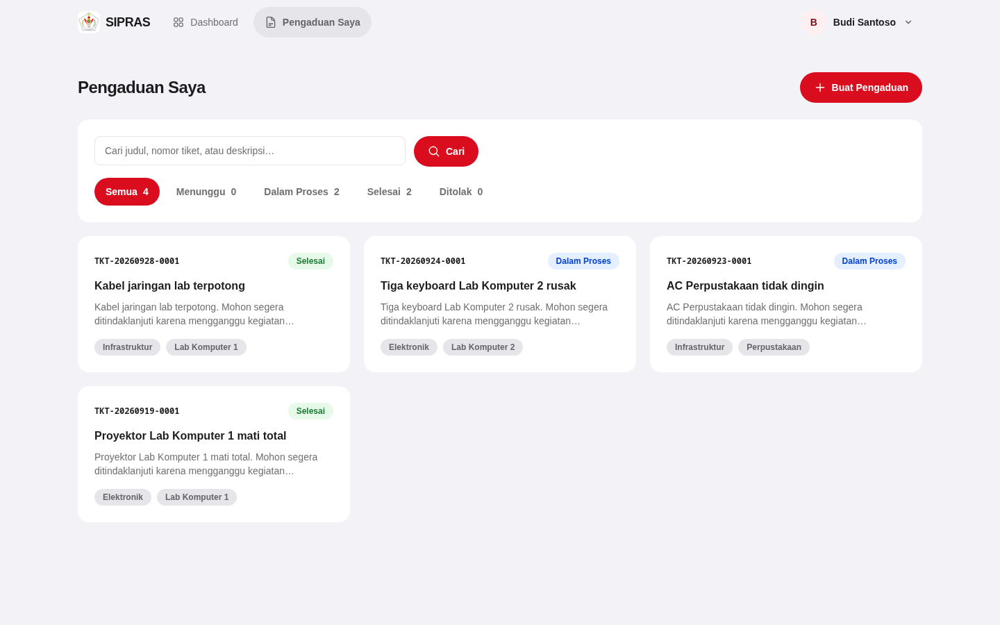

- **Filter chips** — *Semua, Menunggu, Dalam Proses, Selesai, Ditolak*, each
  showing how many of **your** complaints are in that status. The active chip
  is highlighted.
- **Search** — matches title, ticket number or description. Searching keeps
  the chosen status; picking a chip keeps your search term. **Hapus filter**
  clears both.
- Results are paginated (12 per page).
- If a filter combination matches nothing, the page says so and offers
  **Tampilkan Semua**. If you have never filed anything, an onboarding card
  points you at the form instead.

### Tracking a complaint (detail + Linimasa)

Open any card to see the full report: ticket number, status, category, room,
filing time, the **Linimasa** timeline, your description, the evidence photo
and — once the team acts — their response.

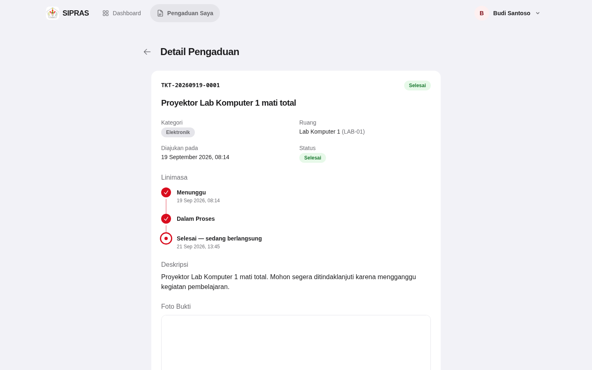

The **Linimasa** shows where the report stands: a blue check for completed
stages, a pulsing dot for the current one, hollow circles for what is left.
Each completed node carries its timestamp. A rejected report has no *Selesai*
node — rejection is the end of its track, and the reason is displayed
prominently together with a **Buat pengaduan baru** shortcut (the problem
might deserve a second, better-described attempt).

What you see per status:

- **Menunggu** — *"Tim Sarana Sekolah sedang meninjau pengaduan Anda."*
- **Dalam Proses** — *"Pengaduan Anda sedang ditangani oleh Tim Sarana Sekolah."*
  The admin's note (e.g. *"menunggu suku cadang"*) appears in the **Catatan
  Admin** panel.
- **Selesai** — a thank-you note, the admin's note, the completion time and,
  if the team uploaded one, the **Dokumentasi Perbaikan** photo.
- **Ditolak** — the reason from **Alasan Penolakan**, plus the resubmit link.

Students can edit a complaint only by filing a new one — reports are immutable
once submitted, so the audit trail in the Linimasa stays trustworthy.

---

## Part 2 — Admin

Admins work from a left-hand sidebar: **Dashboard, Pengaduan, Kategori,
Ruang, Pengguna** (plus Profil/Keluar). On narrow screens the sidebar becomes
a hamburger drawer.

### Dashboard

**Dashboard Admin** shows the same five counts as the student dashboard, but
**global**: every complaint in the system. Each card links into the complaint
list pre-filtered to that status, and **Pengaduan Terbaru** lists the newest
reports from all students.

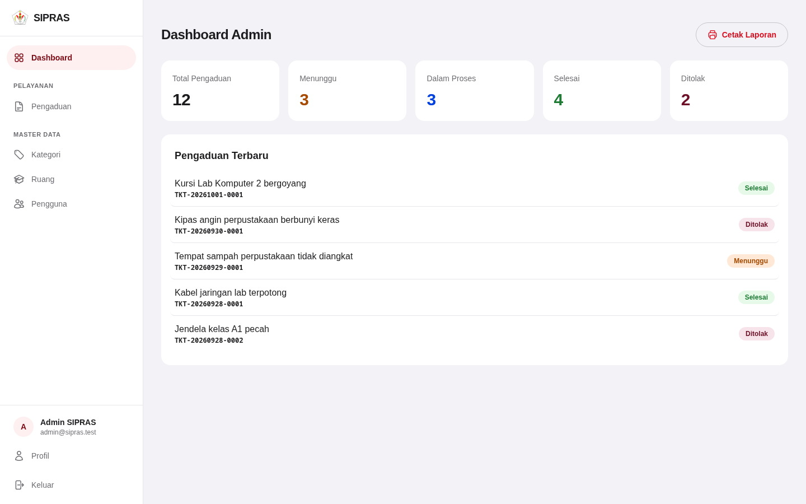

**Cetak Laporan** jumps straight to the [recap report](#reports-recap--pdf).

### Triaging complaints

**Pengaduan** is the working queue: a table of every complaint with ticket
number, title, reporter, room, status badge, filing date and a **Detail**
link.

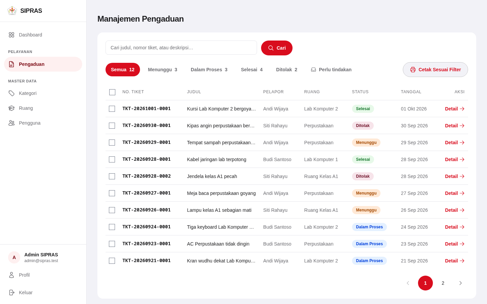

- **Filter pickers** for category, status and period sit on their own row
  below the search field. Status lists *Semua, Menunggu, Dalam Proses,
  Selesai, Ditolak* without counts — the dashboard cards carry the numbers —
  and picking one applies immediately.
- **Search** across title, ticket number, description, reporter name and
  room name; it composes with the pickers, and the period counts by
  tanggal masuk (the complaint's submission date).
- The list is always sorted newest-first; there is no separate sort
  control. Use the status picker to group by triage state instead.
- Lists are paginated (10 per page) and **Cetak Sesuai Filter** opens the
  [report](#reports-recap--pdf) with the exact filters you are looking at.
- The table works on mobile too — rows become cards with the same controls.

### Updating one complaint

**Detail** on any row opens the full report: reporter identity, category,
room, filing time, Linimasa, description, evidence photo — and for resolved
reports, the completion time and proof photo.

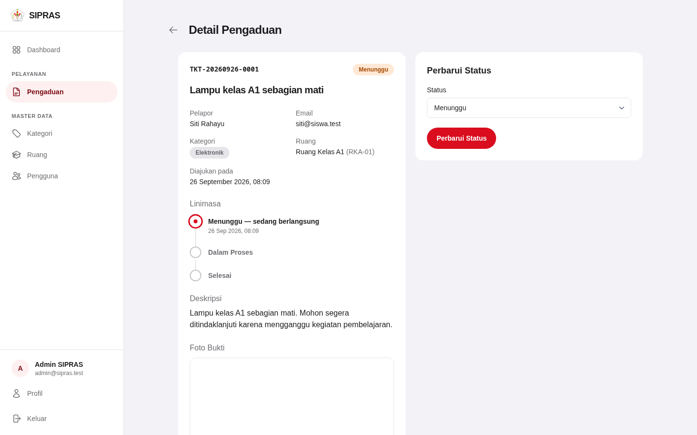

The **Perbarui Status** card on the right is the decision point:

- Pick a status from the dropdown. The form adapts live:
  - **Ditolak** turns the notes field into **Alasan Penolakan** — required,
    because the student will read it. Saving without a reason is rejected by
    validation (*"Catatan admin wajib diisi saat menolak pengaduan."*).
  - **Selesai** shows an optional **Dokumentasi Perbaikan** upload
    (JPG/PNG, max 2 MB) and stamps **resolved_at** — the completion time the
    student and the Linimasa will show.
  - Other notes are optional context ("Catatan Admin (opsional)").
- Click **Perbarui Status**. A green toast confirms the save.

Statuses are not constrained to a fixed order (a complaint can be resolved
straight from *Menunggu* when the fix is trivial), but treat the Linimasa as
the story you are writing: what it shows is what the student sees.

### Master data

Three pages under the sidebar maintain the reference data every complaint is
built from.

#### Categories (Kategori) and rooms (Ruang)

Each is a simple table with **Tambah Kategori** / **Tambah Ruangan** to
create, **Ubah** to edit and **Hapus** to delete (behind a confirmation
dialog).

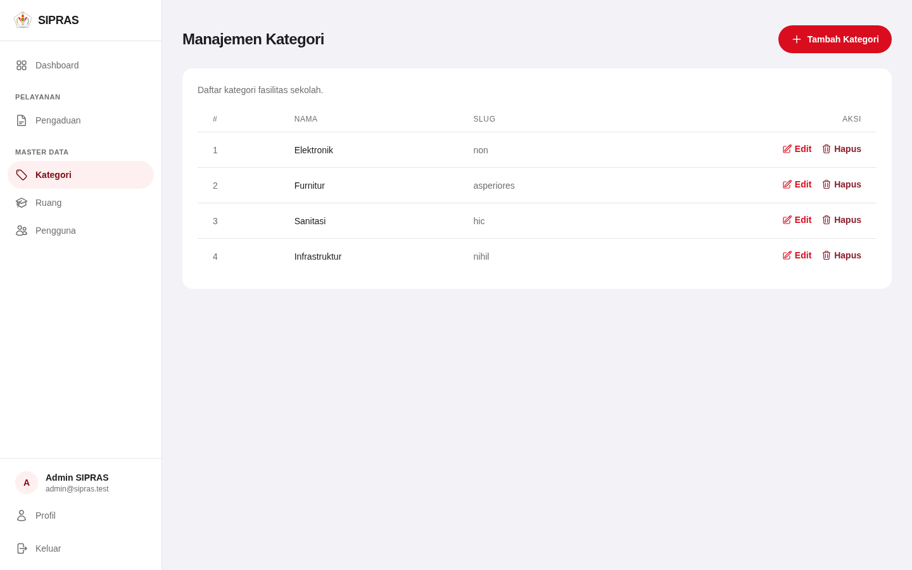

- A category needs only a **name**.
- A room needs a **name** and a short unique **code** (e.g. `LAB-01`).
- **A category or room still referenced by a complaint cannot be deleted** —
  the app refuses with *"…karena masih dipakai pengaduan"* rather than
  breaking the historical record. Fix the data or wait until no complaint
  references it.

#### Managing users (Pengguna)

**Pengguna** lists every account with role and creation date. **Tambah
Pengguna** creates one with a **name**, unique **email**, **password** (min 8
characters, confirmed) and a **role** of `admin` or `siswa`. **Ubah** lets you
rename, change role, or type a new password — leave the password fields blank
to keep the current one.

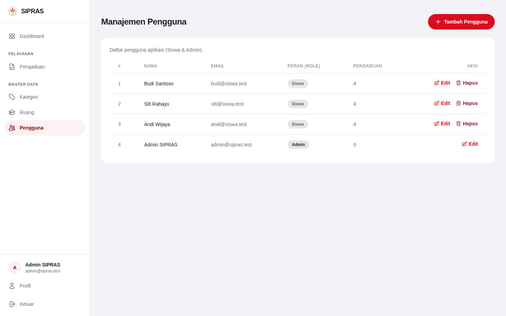

Two guard rails protect the admin from locking themselves out:

- You cannot **delete your own account** (*"Anda tidak dapat menghapus akun
  sendiri."*).
- You cannot **demote your own role** (*"Anda tidak dapat mengubah peran
  (role) akun sendiri."*).

Deleting another user deletes **their complaints too** — rows and uploaded
photo files are swept together in one transaction, so no orphan files or
broken references are left behind.

### Reports (recap + PDF)

**Rekapitulasi Pengaduan Sarana** is a print-ready document, reachable from
the dashboard (**Cetak Laporan**) or from the complaint queue
(**Cetak Sesuai Filter** — which carries your active status/search filters
into the report).

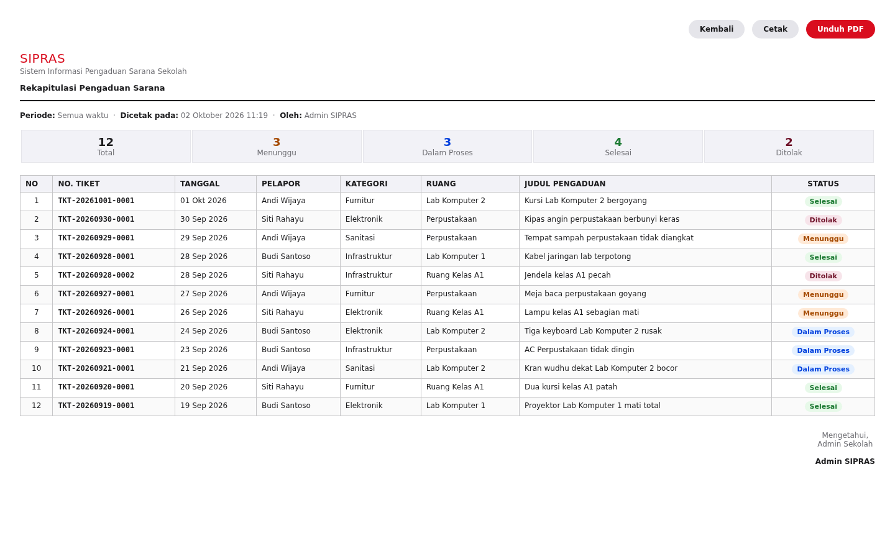

The report contains:

- **Letterhead** with the print date and the name of the admin who printed it.
- A **per-status summary** table (Total / Menunggu / Dalam Proses / Selesai /
  Ditolak) mirroring the dashboard cards.
- The **detail table** — No, ticket, date, reporter, category, room, title,
  status — one row per complaint matching the filters.
- A **signature block** (*Mengetahui, Admin Sekolah*) pre-filled with the
  admin's name.

The toolbar offers **Cetak** (browser print dialog) and **Unduh PDF**, which
generates the same document as a PDF file — filters included. The on-screen
preview and the PDF are pixel-identical by design.

---

## Appendix — seeded demo data

A fresh `php artisan migrate --seed` creates exactly this dataset, so every
screen demos with content:

| Data        | Seeded                                                        |
| ----------- | ------------------------------------------------------------- |
| Users       | 1 admin (`Admin SIPRAS`) + 3 students (Budi, Siti, Andi)      |
| Categories  | Elektronik, Furnitur, Sanitasi, Infrastruktur                 |
| Rooms       | Lab Komputer 1 (`LAB-01`), Lab Komputer 2 (`LAB-02`), Ruang Kelas A1 (`RKA-01`), Perpustakaan (`PRP-01`) |
| Complaints  | 12 reports spread over the last two weeks — 3 Menunggu, 3 Dalam Proses, 4 Selesai (with proof photos), 2 Ditolak (with reasons) |

Every seeded complaint also has an evidence photo, so no screen shows a
broken image. Dates are relative to whenever you seed, keeping the demo
fresh.

### Re-seeding

`php artisan migrate:fresh --seed` drops everything and rebuilds the same demo
data, so you can reset a messy local database in one shot. Complaint photos
live on the public disk and are not part of the database — run
`php artisan storage:link` once, and note that re-seeding clears both seed
image directories.

## Related documents

- [`PRD.md`](../PRD.md) — product requirements (the spec this app implements)
- [`docs/erd.md`](erd.md) — entity relationship diagram and data dictionary
- [`DESIGN.md`](../DESIGN.md) — UI design system
- [`README.md`](../README.md) — installation and development guide
